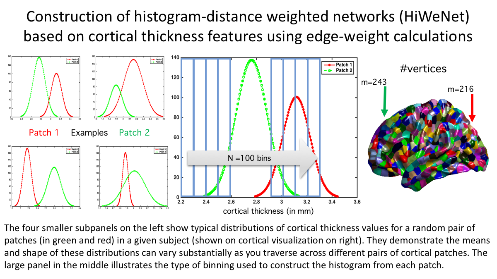

# Histogram-weighted Networks (`hiwenet`)

[](http://joss.theoj.org/papers/df10a3a527fe169447a64c0cc810ff3c)

`hiwenet` computes pairwise distances between groups of node-wise feature
values. Its main role today is as the numerical engine behind
[graynet](https://github.com/raamana/graynet), but it can also be used
directly whenever you need histogram-based or original-distribution-based
distances between groups.

Given:

- a 1D array of feature values
- a matching 1D array of group labels
- a distance metric

`hiwenet` returns either:

- a pairwise distance matrix
- an in-memory NetworkX graph with the same edge weights

This release is intentionally programmatic and does not provide a CLI.



## Installation

```bash
pip install -U hiwenet
```

## Quick Start

```python
import numpy as np

from hiwenet import extract

features = np.array([0.2, 0.1, 0.3, 1.0, 1.2, 0.9])
groups = np.array([0, 0, 0, 1, 1, 1])

edge_weights = extract(
    features,
    groups,
    weight_method="manhattan",
)
```

The default output matches what `graynet` expects: a square NumPy array whose
upper triangle stores the pairwise edge weights.

## API

### `extract`

`extract()` is the main entry point.

```python
from hiwenet import extract

edge_weights = extract(
    features,
    groups,
    weight_method="manhattan",
    num_bins=25,
    edge_range=None,
    trim_outliers=True,
    trim_percentile=5,
    use_original_distribution=False,
    relative_to_all=False,
    asymmetric=False,
    return_networkx_graph=False,
)
```

### `ExtractConfig`

If you prefer a validated configuration object:

```python
from hiwenet import ExtractConfig, extract_with_config

config = ExtractConfig(
    weight_method="manhattan",
    num_bins=25,
)

edge_weights = extract_with_config(features, groups, config)
```

## Metrics

`hiwenet` supports both histogram-based distances and distances that operate on
the original values in each group.

Histogram-based metrics include:

- `manhattan`
- `euclidean`
- `chebyshev`
- `braycurtis`
- `canberra`
- `cosine`
- `correlation`
- `emd`
- `kl_divergence`
- `js_divergence`

Original-distribution metrics include:

- `diff_medians`
- `diff_medians_abs`
- `diff_means`
- `diff_means_abs`
- `exp_diff_means_norm_std`
- `ranksum_statistic`

Custom callables are also supported.

## Relative-To-All

`relative_to_all=True` remains available for workflows that compare each group
against the pooled distribution from all groups.

## Scientific Notes

- Explicit `edge_range` values are useful when you need consistent histogram
  support across subjects.
- Built-in non-histogram metrics operate on the original values in each group.
- Degenerate histogram cases are handled deterministically in this release
  instead of relying on runtime-warning-driven `NaN` outputs.

## Development

```bash
pytest -q
hatch build
```

## Citation

If `hiwenet` is useful in your work, please cite the JOSS paper linked above.
